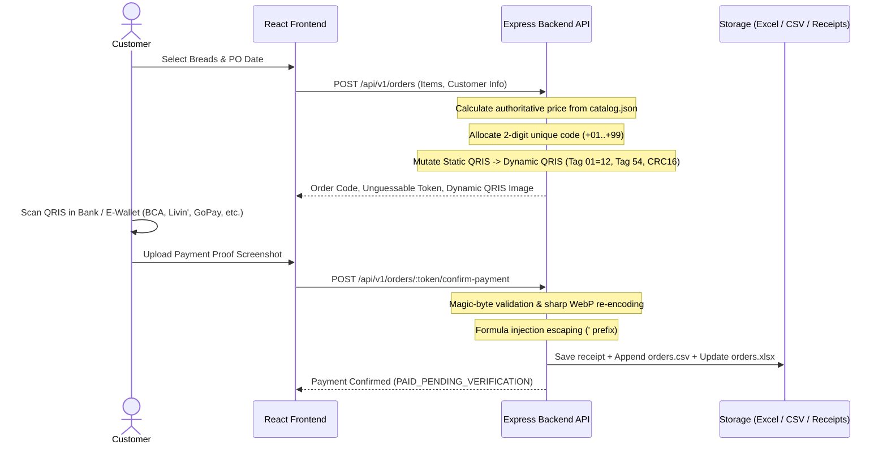

# Dizz Baked Goods Web Application 🍞✨

> Modern, mobile-first artisanal bakery Pre-Order (PO) web application featuring a zero-fee server-side **Static-to-Dynamic QRIS payment engine** with unique verification cents, automated receipt sanitization, and resilient multi-sheet Excel / CSV audit persistence.

---

## 🏛️ Project Architecture & Layout

This repository is organized as a decoupled TypeScript monorepo designed for self-hosting on VPS/local servers, with explicit forward compatibility for native Android (CapacitorJS) packaging:

```text
dizz-baked-goods-webapp/
├── .gitignore                        # Comprehensive exclusions (node_modules, storage, secrets)
├── package.json                      # Monorepo workspace configuration
├── README.md                         # Project overview and runbook
├── docs/                             # Full architectural & roadmap documentation
│   ├── implementation_plan.md        # Detailed Phase 1 (MVP) implementation specification
│   ├── future_roadmap.md             # Post-MVP plan (Phases 2–6) and Android track (Phases M1–M3)
│   └── README.md                     # Documentation index
├── ai-governance/                    # AI Agent Governance, Constitution & Compliance Rules
│   ├── README.md                     # Overview of AI operating standards
│   ├── AI_CONSTITUTION.md            # Non-negotiable safety & architectural principles
│   ├── SECURITY_POLICY.md            # Zero-trust security directives & defense-in-depth rules
│   ├── AGENT_ROLES.md                # Specialized roles & responsibilities for AI collaborators
│   ├── COMPLIANCE_STANDARDS.md       # EMVCo QRIS, Bank Indonesia & UU PDP privacy compliance
│   └── CHANGE_CONTROL.md             # Quality gates, verification steps & audit policy
├── memory/                           # Persistent AI Memory & Context Architecture
│   ├── README.md                     # Memory framework guide
│   ├── ACTIVE_CONTEXT.md             # Current sprint focus, system status & immediate tasks
│   ├── SYSTEM_PATTERNS.md            # Code conventions, repository pattern & error handling
│   ├── PRODUCT_KNOWLEDGE.md          # Bakery domain concepts, PO cycles & business rules
│   ├── ROADMAP_PROGRESS.md           # Milestone & phase tracking
│   └── DECISIONS/                    # Architectural Decision Records (ADRs)
│       ├── ADR-001-static-to-dynamic-qris.md
│       ├── ADR-002-dual-storage-exceljs-csv.md
│       ├── ADR-003-storage-decoupling-repository-pattern.md
│       └── ADR-004-react-vite-capacitor-foundation.md
├── backend/                          # Express + TypeScript + Zod REST API
│   ├── .env.example                  # Environment configuration template
│   ├── package.json                  # Express, ExcelJS, Sharp, Multer, Zod, QRCode
│   ├── tsconfig.json
│   ├── data/
│   │   └── catalog.json              # Authoritative bread catalog & PO batch settings
│   ├── storage/                      # Runtime persistence directory (git-ignored)
│   │   ├── orders.xlsx               # Formatted 2-sheet Excel workbook for baker
│   │   ├── orders.csv                # Append-only flat-file audit backup
│   │   ├── orders_ledger.json        # Order state & active unique code registry
│   │   └── receipts/                 # Sanitized .webp payment screenshots
│   ├── scripts/
│   │   └── migrateToDb.ts            # Forward-compatible Phase 3 DB migration template
│   ├── src/
│   │   ├── index.ts                  # App bootstrap & startup QRIS self-check
│   │   ├── config/env.ts             # Zod environment validation & multi-origin CORS
│   │   ├── middleware/               # Rate limiting, uploads, and error handling
│   │   ├── services/                 # QRIS engine, unique codes, receipts, storage
│   │   ├── routes/v1/                # REST endpoints (/catalog, /orders)
│   │   ├── schemas/                  # Zod validation & formula-injection sanitizers
│   │   └── types/                    # Domain models & IOrderRepository interface
│   └── tests/                        # Vitest unit & integration test suite
└── frontend/                         # React 19 + Vite + TypeScript + Tailwind CSS
    ├── .env.example                  # VITE_API_BASE_URL
    ├── package.json
    ├── vite.config.ts
    ├── index.html
    ├── public/images/breads/         # Sample bakery product photos
    └── src/
        ├── api/client.ts             # Typed API client
        ├── utils/platform.ts         # Platform abstractions (Web vs. Capacitor Android)
        ├── context/CartContext.tsx   # Persistent cart state
        ├── components/               # UI components (Banner, ProductCard, Drawer, QRIS, Uploader)
        └── pages/                    # Catalog, Checkout, and Order Payment screens
```

---

## 🚀 Quick Start

### 1. Prerequisites
- Node.js 20+ LTS or Node.js 24 LTS
- npm or pnpm

### 2. Install Dependencies
```bash
# In the repository root:
npm install
```

### 3. Configure Environment Variables
```bash
# Backend environment:
cp backend/.env.example backend/.env

# Frontend environment:
cp frontend/.env.example frontend/.env
```

### 4. Run Development Servers
```bash
# Run both frontend & backend concurrently:
npm run dev

# Or run separately:
npm run dev:backend   # API on http://localhost:4000
npm run dev:frontend  # Storefront on http://localhost:5173
```

---

## 💳 Static-to-Dynamic QRIS Flow



---

## 🛡️ Governance & Memory

This project implements formal **AI Governance** (`ai-governance/`) and an **AI Memory Architecture** (`memory/`) ensuring that any AI agent or human contributor follows strict safety invariants:
- **Authoritative Backend Pricing**: Client-side prices are never trusted.
- **Formula Injection Defense**: All user strings entering `.xlsx` or `.csv` are sanitized.
- **Sanitized Binary Uploads**: Receipts are stripped of metadata and re-encoded via `sharp`.
- **Decoupled Architecture**: Storage implements `IOrderRepository` for frictionless SQLite/Postgres cutover in Phase 3.
