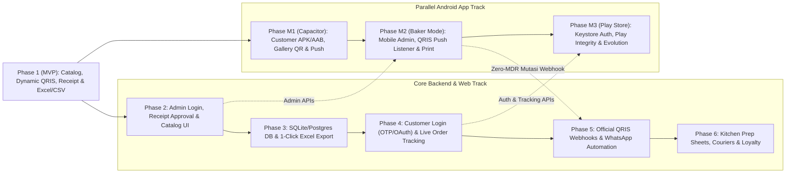

# Dizz Baked Goods — Post-MVP Roadmap & Future Features Plan

This roadmap serves as the standalone strategic and technical plan for evolving **Dizz Baked Goods** beyond the [Phase 1 (MVP) Implementation Plan](./implementation_plan.md). Each phase is modular so you can launch quickly on flat files today and upgrade incrementally without rewriting the React frontend or breaking Phase 1 APIs.

---

## Parallel Track: Android Mobile Application (`Phase M1` – `Phase M3`)

**Goal:** Deliver an installable Android app (`.apk` for direct WhatsApp/Instagram bio distribution first, `.aab` for Google Play Store later) **in parallel** with backend/web phases—reusing the Phase 1 React (Vite) UI and Express REST API with minimal duplicate work.

> [!TIP]
> **Why you already chose the ideal stack for Android:** Because Phase 1 uses a **standalone React (Vite) SPA** communicating with a **decoupled REST API**, we can wrap `frontend/` with **CapacitorJS** immediately after Phase 1 to compile a real native Android project (`frontend/android/`) sharing ~95% of your web codebase.

### Phase M1: Customer Android App via CapacitorJS (Can Start Right After Phase 1)
- **Single Codebase -> Web + Android `.apk`**:
  - Add `@capacitor/core` and `@capacitor/android` to `frontend/`, compiling the Vite bundle into a native Android app shell with custom bakery app icon and splash screen.
  - Distribute directly as a signed `.apk` link to loyal Pre-Order customers immediately, even before setting up a Google Play Console account.
- **Native QRIS Checkout Enhancements (Huge UX Upgrade over Mobile Web)**:
  - **1-Tap Save QRIS to Android `MediaStore` Gallery**: Uses `@capacitor-community/media` / `@capacitor/filesystem` so when a customer taps *"Save QR to Pay"*, the Dynamic QRIS appears directly as the newest image in their phone gallery—ready for BCA Mobile, Livin', BRImo, GoPay, or ShopeePay *"Scan from Gallery"*.
  - **Android 13/14+ Native Scoped Photo Picker (`@capacitor/camera`)**: Clean native bottom sheet to pick the payment receipt screenshot without requesting invasive `READ_EXTERNAL_STORAGE` / `READ_MEDIA_IMAGES` permissions.
- **Push Notifications & Deep Links**:
  - **Firebase Cloud Messaging (FCM)**: Push alerts when a new weekend bread Pre-Order batch opens (*"Saturday Sourdough PO is live — 25 loaves available!"*).
  - **Android App Links**: Tapping an order link from WhatsApp opens directly inside the installed Android app.

### Phase M2: Baker Companion Mode & Zero-MDR Payment Listener (Parallels Phase 2 & 5)
- **Pocket Admin Queue**: Once Phase 2 Admin APIs exist, the baker can sign in on the Android app to receive high-priority sound alerts for new uploaded receipts and approve orders in 1 tap from the kitchen.
- **Built-in QRIS Notification Auto-Verifier (Connects to Phase 5 Option B)**:
  - A dedicated baker-only Android module (or companion APK) using Android's `NotificationListenerService` can detect incoming payment notifications from **GoPay Merchant / Livin' Merchant / BCA / Dana** on the baker's shop phone and send an `HMAC-SHA256`-signed webhook to the backend—automatically matching the `+01..+99` unique amount code and marking the order `VERIFIED_PAID` with **0% payment gateway fees**.
- **Bluetooth Thermal Label Printing**: Print customer bag stickers (Name, PO Date, Bread Items) directly from the baker's Android phone to an affordable 58mm/80mm Bluetooth thermal printer.

### Phase M3: Google Play Store Launch, Mobile Security & Native Evolution (Parallels Phase 4–6)
- **Google Play Store Release (`.aab`)**:
  - Configure Play App Signing, Google Play Data Safety declarations (disclosing name, phone, address, and payment receipt uploads), and in-app account deletion link (mandatory Play Store policy once Phase 4 customer accounts launch).
- **Android-Specific Security Controls**:
  - **Encrypted Token Storage**: Store customer/admin auth tokens inside Android's hardware-backed **Keystore (`EncryptedSharedPreferences`)** via `@capacitor-community/secure-storage`—never in plain WebView `localStorage`.
  - **Network & Device Integrity**: Enforce HTTPS-only traffic via Android `network_security_config.xml` (blocking cleartext HTTP in production) and enable **Google Play Integrity API** to block tampered/repackaged APKs from abusing checkout APIs.
- **Optional Long-Term Native Upgrade (React Native / Expo)**:
  - If Dizz Baked Goods eventually wants fully native 120fps animations, native map courier tracking, or Android Home Screen widgets, extract shared TypeScript DTOs and Zod schemas into `packages/shared/` and build an **Expo (React Native)** client against the exact same `/api/*` backend.

---

## Phase 2: Admin Authentication, Verification Queue & Catalog Management

**Goal:** Eliminate manual SSH/file-folder inspection by giving the baker a secure `/admin` portal to verify payment receipts, update order statuses, manage bread availability, and download `.xlsx` reports from any device.

### Features
- **Admin Login Portal (`/admin/login`)**: Secure owner/staff sign-in.
- **Payment Verification Queue**: Side-by-side view showing each order's **Expected Total (`Rp 85.024`)**, customer info, and zoomed **Receipt Screenshot**, with one-click **Approve (`VERIFIED_PAID`)** or **Flag/Reject** buttons that automatically update the Excel workbook.
- **Browser-Based Catalog & PO Batch Editor**:
  - Create/edit Pre-Order batches (open/close PO window, configure pickup dates, set max loaf quotas per bake day).
  - Add new breads, upload product photos, toggle Sold Out / Seasonal items, and adjust prices without editing `catalog.json` manually.
- **Remote Excel Download**: Authenticated `GET /api/admin/exports/orders.xlsx?batch=...` endpoint so you can download the formatted Excel sheet straight to your phone or laptop.

### Login & Security Architecture (Admin)
- **Password Storage**: Hash admin credentials with **Argon2id** (never plain SHA or bcrypt with low cost).
- **Dual-Mode Session Management (Web + Android Ready)**: Stateful **HttpOnly, `Secure`, `SameSite=Lax` session cookies** + **CSRF token** enforcement for browser sessions, paired with short-lived **`Authorization: Bearer` access + refresh tokens** for the parallel Android app (stored in Android Keystore).
- **Brute-Force & 2FA**: Strict login rate limiting (e.g., 5 attempts / 15 mins + exponential backoff) and optional **TOTP 2FA** (Google/Microsoft Authenticator) for owner accounts.
- **Private Receipt Streaming**: Receipt images remain outside public static folders and are streamed only through an authenticated admin route (`GET /api/admin/receipts/:orderId`).

---

## Phase 3: Database Migration (Flat File -> Relational DB + Excel Export Retained)

**Goal:** Replace flat-file storage as order volume grows, solving concurrent stock reservations, multi-batch filtering, and relational reporting—while **keeping 1-click Excel (`.xlsx`) export** so your spreadsheet workflow doesn't change.

### Features
- **Relational Schema (`PostgreSQL` or `SQLite` via Drizzle/Prisma)**:
  - Core tables: `users`, `po_batches`, `products`, `product_variants`, `orders`, `order_items`, `payments`, `audit_logs`.
- **Atomic Pre-Order Quota Reservations**:
  - If you can only bake **30 Country Sourdough loaves** on Saturday, checking out places a 20-minute database-transactional hold on stock so two customers never over-order the last loaf.
- **Zero-Data-Loss Migration Script**:
  - One-time CLI importer (`npm run migrate:flatfile-to-db`) that reads existing `orders_ledger.json` / `orders.csv` + `catalog.json` and imports historical customers, orders, and receipts into the database.

> [!IMPORTANT]
> **Designing Phase 1 for Easy Phase 3 Migration:** Because Phase 1 isolates all file reads/writes inside `storageService.ts` and `catalogService.ts` behind clean TypeScript interfaces, migrating to PostgreSQL or SQLite in Phase 3 requires swapping only the service layer—the React UI and QRIS logic stay untouched.

---

## Phase 4: Customer Login, Profiles & Live Order Tracking

**Goal:** Reward repeat bakery customers with faster checkout, saved addresses, and live bake-day order status—while **preserving Guest Checkout** so first-time buyers from Instagram/WhatsApp never hit a login wall.

### Features
- **Frictionless Customer Login**:
  - **Google OAuth ("Continue with Google")** and/or **WhatsApp / Email 6-digit OTP (Passwordless)**—ideal for bakery shoppers who dislike remembering passwords.
  - Automatic linking of past guest orders matching verified WhatsApp/email (after OTP verification).
- **Saved Profiles & 1-Click Reorder**:
  - Save multiple delivery addresses (Home, Office, Gift recipient) and dietary notes.
  - "Order Again" button from past PO batches.
- **Live Bake-Day Status Tracker**:
  - Visual timeline: `Payment Received` -> `Confirmed for Friday Bake` -> `In the Oven / Cooling` -> `Ready for Pickup / Handed to Courier`.

### Login & Security Architecture (Customer)
- **Role-Based Access Control (RBAC)**: Strict middleware separation between `CUSTOMER`, `STAFF` (kitchen prep & order fulfillment), and `OWNER` (pricing, payouts, exports).
- **OTP Hardening**: Short-lived OTPs (5 minutes), hashed in DB, max 3 verification attempts per code, and per-phone/IP rate limits to prevent SMS/WhatsApp pumping fraud.
- **PII & Privacy Protection**: Customers can only access orders tied to their authenticated `user_id` (or single-order magic token for guests). Support account/PII deletion requests.

---

## Phase 5: Automated Payment Verification & WhatsApp Notifications

**Goal:** Remove manual receipt checking and manual customer follow-ups completely so orders flow from checkout -> verified paid -> kitchen queue -> customer WhatsApp confirmation automatically 24/7.

### Two Upgrade Paths for Payment Automation
1. **Option A — Official Payment Gateway API (Recommended at Scale)**:
   - Integrate **Midtrans, Xendit, or Durianpay Dynamic QRIS API** (typically ~0.7% MDR).
   - Gateway generates an official per-transaction Dynamic QRIS and fires a **cryptographically signed webhook** (`POST /api/v1/webhooks/payment`) the instant the customer pays—no unique 2-digit code or screenshot upload needed!
2. **Option B — Zero-MDR Automated Mutation Listener (Indie / Low-Cost Option)**:
   - Keep Static-to-Dynamic QRIS + 2-digit unique code, and deploy a lightweight private Android notification forwarder (reading GoPay Merchant / Soundbox / Livin' Merchant notifications) that POSTs incoming amount notifications (`HMAC-SHA256` signed) to your backend to auto-match `Rp 85.024` -> `VERIFIED_PAID`.

### Automated Customer Messaging
- **WhatsApp Business API / Fonnte / Waha Integration**:
  - Instant message on checkout (with payment link), instant receipt when payment is verified, and automated pickup/delivery reminder on bake morning.

### Webhook Security Controls
- Verify **HMAC signatures** (`X-Callback-Token` / Midtrans `signature_key`), enforce **idempotency keys** so duplicate webhooks never double-count revenue, and reconcile webhook amounts against server-stored `order.totalAmount`.

---

## Phase 6: Bakery Operations, Courier Integration & Growth Features

**Goal:** Turn the webapp from a storefront into a complete micro-bakery operating system for **Dizz Baked Goods**.

| Area | Planned Features |
| :--- | :--- |
| **Baker's Kitchen Prep Sheet** | Auto-calculate total dough weights, fillings, and packaging needed for each bake date (e.g., *"Saturday PO: 24x Sourdough = 12 kg flour, 3.6 kg levain"*). Printable PDF/thermal label slips per customer bag. |
| **Instant Courier Integration** | Integrate **Biteship / Gosend / GrabExpress / Paxel** pin-point map picker to calculate instant local delivery fees at checkout and book couriers in 1 click when bread finishes cooling. |
| **Bread Bundles & Hampers** | Custom box builder (*"Pick any 6 Sweet Buns for Rp 110.000"*), seasonal Eid/Christmas hamper pre-orders with custom greeting card messages. |
| **Promos & Bread Stamp Card** | Voucher codes (`FIRSTLOAF`, free delivery tiers) and a digital stamp card (*Buy 10 loaves, get 1 free*) tied to customer accounts. |
| **Analytics & Accounting** | Best-selling bread margins, PO sell-out velocity, repeat customer cohort metrics, and monthly CSV/Excel bookkeeping exports. |
