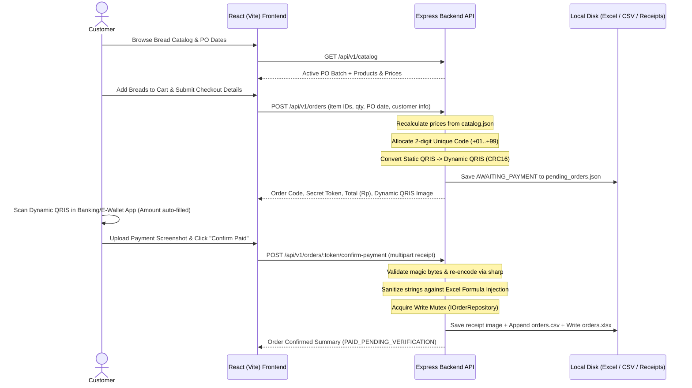

# Dizz Baked Goods — Phase 1 (MVP) Implementation Plan

This plan covers building **Phase 1 (MVP)** of the **Dizz Baked Goods** web application: browsing a Pre-Order (PO) bread catalog, placing an order, paying via a server-generated **Static-to-Dynamic QRIS** (with a unique 2-digit verification code), uploading payment proof, and persisting paid orders into local **Excel (`.xlsx`) and flat-file (`.csv` / `.json`)** storage—hardened with essential MVP security controls.

For post-MVP authentication (Admin & Customer login), database migration, automated payment webhooks, and operational features, see the companion [Future Roadmap & Post-MVP Plan](./future_roadmap.md).

---

## 1. Architecture & Tech Stack Overview

We will use a clean, decoupled **TypeScript monorepo-style layout** (`frontend/` + `backend/`) designed for self-hosting on a VPS or local server with persistent disk storage:

| Layer | Technology | Rationale |
| :--- | :--- | :--- |
| **Frontend** | **React 19 + Vite + TypeScript + Tailwind CSS** | Fast SPA catalog & checkout flow, mobile-first bakery aesthetic, cart state persisted in `localStorage`. |
| **Backend API** | **Node.js + Express + TypeScript** | Shares TypeScript/Zod validation schemas concepts, handles authoritative pricing, QRIS generation, receipt sanitization, and file locks. |
| **QRIS Engine** | Custom **EMVCo TLV + CRC-16/CCITT-FALSE** module + `qrcode` | Parses merchant Static QRIS from `.env`, injects dynamic tag + exact payable IDR amount, recalculates checksum, and renders QR Data URL. |
| **Receipt Handling** | `multer` (memory) + `file-type` + `sharp` | Validates image magic bytes, strips metadata/polyglot payloads, converts to compact `.webp`, and stores safely on disk. |
| **Flat-File Storage** | `exceljs` (`.xlsx`) + native CSV + JSON ledger + `async-mutex` | Writes formatted multi-sheet Excel workbooks for the baker alongside an append-only CSV backup and write-lock protection. |



---

## 2. Proposed Project Directory Structure

All project files will be created inside `r:\My Drive\[04] DEVELOPMENT\dizz-baked-goods-webapp`:

```text
dizz-baked-goods-webapp/
├── .gitignore                        # Excludes node_modules, .env, backend/storage/
├── README.md                         # Setup, QRIS extraction guide, & VPS deployment docs
├── backend/
│   ├── .env.example                  # STATIC_QRIS_PAYLOAD, PORT, FRONTEND_URL, etc.
│   ├── package.json
│   ├── tsconfig.json
│   ├── data/
│   │   └── catalog.json              # Authoritative PO batch config & bread catalog
│   ├── scripts/
│   │   └── migrateToDb.ts            # Staged migration script skeleton for Phase 3 DB cutover
│   ├── storage/                      # Git-ignored runtime persistence directory
│   │   ├── orders.xlsx               # Formatted 2-sheet Excel workbook for baker
│   │   ├── orders.csv                # Append-only flat-file audit backup
│   │   ├── orders_ledger.json        # Order state & active unique code registry
│   │   └── receipts/                 # Sanitized .webp payment proof images
│   ├── src/
│   │   ├── index.ts                  # Express app bootstrap & startup QRIS self-check
│   │   ├── config/
│   │   │   └── env.ts                # Zod-validated environment configuration (multi-origin CORS)
│   │   ├── middleware/
│   │   │   ├── rateLimiter.ts        # Checkout & upload IP rate limiters
│   │   │   ├── upload.ts             # Multer memory storage & size guard
│   │   │   └── errorHandler.ts       # Safe error responses (no stack trace leaks)
│   │   ├── services/
│   │   │   ├── catalogService.ts     # Reads & validates catalog.json + PO cutoff dates
│   │   │   ├── qrisService.ts        # EMVCo TLV parser, Static->Dynamic mutator, CRC16
│   │   │   ├── uniqueCodeService.ts  # Allocates & recycles +01..+99 unique codes
│   │   │   ├── receiptService.ts     # Magic-byte check & sharp image re-encoding
│   │   │   └── storageService.ts     # Implements IOrderRepository (Mutex-locked CSV + ExcelJS + EBUSY retry)
│   │   ├── routes/
│   │   │   └── v1/
│   │   │       ├── index.ts          # Mounts /api/v1 router
│   │   │       ├── catalogRoutes.ts  # GET /api/v1/catalog
│   │   │       └── orderRoutes.ts    # POST /api/v1/orders, GET /api/v1/orders/:token, POST .../confirm-payment
│   │   ├── schemas/
│   │   │   └── orderSchemas.ts       # Zod input schemas & CSV-injection sanitizer
│   │   └── types/
│   │       ├── domain.ts             # Shared domain models (Order, Customer, Payment, Item)
│   │       └── storage.ts            # IOrderRepository interface (decoupling storage for Phase 3 DB)
│   └── tests/
│       ├── qrisService.test.ts       # Unit tests for TLV parsing & CRC-16 vectors
│       └── storageService.test.ts    # Unit tests for formula sanitization & Excel output
└── frontend/
    ├── .env.example                  # VITE_API_BASE_URL
    ├── package.json
    ├── vite.config.ts
    ├── index.html
    ├── public/
    │   └── images/breads/            # Sample/initial bakery product photography
    └── src/
        ├── main.tsx
        ├── App.tsx
        ├── api/
        │   └── client.ts             # Typed fetch wrapper using explicit VITE_API_BASE_URL
        ├── utils/
        │   └── platform.ts           # Abstracts QR download & receipt picker for Web + future Android (Capacitor)
        ├── context/
        │   └── CartContext.tsx       # Persistent cart state & PO date selection
        ├── components/
        │   ├── Header.tsx            # Brand header, active PO badge, cart drawer trigger
        │   ├── PoBanner.tsx          # Pre-Order cutoff countdown & available bake dates
        │   ├── CategoryFilter.tsx    # Filter breads by category (Sourdough, Buns, etc.)
        │   ├── ProductCard.tsx       # Bread card with photo, tags, price, qty controls
        │   ├── CartDrawer.tsx        # Slide-over cart review & subtotal
        │   ├── CheckoutForm.tsx      # Name, WhatsApp, Fulfillment (Pickup/Delivery), Date, Notes
        │   ├── QrisPaymentView.tsx   # Dynamic QRIS display, Download QR, exact Rp breakdown, countdown
        │   └── ReceiptUploader.tsx   # Drag/tap image preview & "I've Paid" submission
        └── pages/
            ├── CatalogPage.tsx       # Main storefront
            ├── CheckoutPage.tsx      # Order details submission
            └── OrderPaymentPage.tsx  # Dynamic QRIS payment + receipt upload + final receipt
```

---

## 3. Core Technical Specifications

### 3.1 Static-to-Dynamic QRIS Engine (`qrisService.ts`)
Indonesian QRIS follows the **EMVCo Merchant-Presented QR Specification**. Because Static-to-Dynamic conversion is generated offline without an acquirer API, precision is critical for compatibility across BCA, Livin' Mandiri, BRImo, GoPay, OVO, Dana, and ShopeePay:

1. **Startup Validation**: When the server starts, `qrisService` parses `STATIC_QRIS_PAYLOAD` from `.env` and verifies its existing Tag `63` CRC-16 checksum so configuration copy-paste errors fail immediately.
2. **TLV Parsing & Mutation**:
   - Parse top-level `[Tag (2 chars)][Length (2 chars)][Value (Length chars)]` entries.
   - **Tag `01` (Point of Initiation Method)**: Mutate `"11"` (Static) to `"12"` (Dynamic).
   - **Tag `53` (Currency)** & **Tag `58` (Country)**: Verify `"360"` (IDR) and `"ID"`.
   - **Tag `54` (Transaction Amount)**: Insert/replace immediately after Tag `53` with whole integer Rupiah string (e.g., `Rp 85.037` -> Tag `54`, Length `05`, Value `"85037"` -> `"540585037"`).
   - **Tag `55`–`57` (Tip/Convenience Fee)**: Strip if present so banking apps lock the exact total without prompting for tips.
   - **Tag `62` (Additional Data)**: Preserve original merchant Tag `62` untouched so strict banking apps validate the merchant's original terminal sub-tags.
3. **CRC-16/CCITT-FALSE Checksum (Tag `63`)**:
   - Strip original Tag `63`, append `"6304"`, compute CRC-16 (`poly = 0x1021`, `init = 0xFFFF`, `xorOut = 0x0000`, non-reflected) across ASCII bytes, and append 4 uppercase hex digits.
4. **QR Rendering**: Render high-contrast PNG Data URL (plus downloadable QR image button for mobile users paying on the same phone via gallery scan!).

> [!TIP]
> Most customers browse bakery catalogs on their smartphone and pay using mobile banking **on that same phone** (via "Scan from Gallery"). Including a one-tap **"Download QR Image"** button and a **"Copy Exact Amount"** fallback alongside the QR display dramatically reduces mobile checkout drop-off.

### 3.2 Unique 2-Digit Payment Verification Flow (`uniqueCodeService.ts`)
Since converted Static QRIS does not send automated bank webhooks:
- Each checkout allocates a **2-digit unique code (`+1` to `+99`)** scoped per base subtotal across active (`AWAITING_PAYMENT`, 30-minute TTL) and recent orders (e.g., Subtotal `Rp 85.000` + Unique Code `Rp 24` = **Dynamic QRIS locked at `Rp 85.024`**).
- Customer scans the QRIS (banking app automatically fills `Rp 85.024`), pays, takes a screenshot, and uploads it via `ReceiptUploader`.
- Only **after** the customer submits their payment confirmation + receipt does the backend mark the order `PAID_PENDING_VERIFICATION` and write it into the baker's Excel/CSV files.

### 3.3 Resilient Excel & Flat-File Persistence (`storageService.ts`)
Writing directly to `.xlsx` in a live web server requires careful concurrency and file-lock handling:

1. **In-Memory Async Mutex**: All file writes pass through a single `Mutex` queue so concurrent customer checkouts never interleave writes or corrupt the `.xlsx` ZIP structure.
2. **Dual-Format Write Strategy**:
   - **`orders.csv`** (Append-only flat file): Immediately appends every confirmed order row. Acts as an indestructible flat-file audit log.
   - **`orders.xlsx`** (Formatted Excel Workbook via `exceljs`):
     - **Worksheet 1 — `Paid Orders`**: `Order Code`, `Paid Timestamp`, `Status`, `PO Batch`, `Fulfillment Date`, `Fulfillment Type`, `Customer Name`, `WhatsApp`, `Address / Notes`, `Items Summary`, `Subtotal (Rp)`, `Unique Code (Rp)`, `Total QRIS Paid (Rp)`, `Receipt File Path`.
     - **Worksheet 2 — `Bake Prep Line Items`**: Normalized one-row-per-bread-item (`Order Code`, `Fulfillment Date`, `Customer Name`, `Product ID`, `Bread Name`, `Quantity`, `Unit Price`, `Line Total`)—allowing the baker to filter or pivot by date to see *"Total loaves to bake per variety"*.
3. **Atomic Write & Windows/Excel Lock Recovery**:
   - `orders.xlsx` is rebuilt/updated to `orders.tmp.xlsx` and atomically renamed to `orders.xlsx`.

> [!WARNING]
> On Windows or Google Drive-synced folders, opening `orders.xlsx` directly in Microsoft Excel places an OS lock (`EBUSY` / `EPERM`) on the file. `storageService` will catch lock errors, still commit immediately to `orders.csv` + `orders_ledger.json`, mark `xlsxSyncPending = true`, and automatically retry syncing `orders.xlsx` in the background once Excel closes—guaranteeing **zero lost orders**.

### 3.4 Android-Ready Foundations (Preparing for Parallel Phase M1)
To ensure the parallel Android App track in [future_roadmap.md](./future_roadmap.md) can wrap `frontend/` into an `.apk`/`.aab` without refactoring:
- **Explicit Base URL & Multi-Origin CORS**: `client.ts` always resolves against `VITE_API_BASE_URL` (never assuming browser-only relative paths), and backend CORS accepts comma-separated `ALLOWED_ORIGINS` (ready for `https://localhost` and `capacitor://localhost` Android WebView origins).
- **Platform Adapter (`utils/platform.ts`)**: Isolates *"Save QRIS Image"* and *"Pick Receipt Image"* behind clean helpers so Phase M1 can swap `<a download>` / `<input type="file">` with native Android `MediaStore` gallery saving and Scoped Photo Picker in one file.
- **Mobile Viewport & Safe-Area Ergonomics**: Configures `viewport-fit=cover`, CSS `env(safe-area-inset-*)` padding for Android status/gesture bars, and thumb-friendly 44px+ tap targets.

---

## 4. Future Roadmap Synchronization & Forward-Compatibility Architecture

To make Phase 1 seamlessly evolve into the phases outlined in [Future Roadmap & Post-MVP Plan](./future_roadmap.md), Phase 1 embeds explicit architectural hooks across domain models, service boundaries, and API routes:

### 4.1 Storage Decoupling via Repository Pattern (`IOrderRepository`)
Phase 1 persists data using flat files (`orders.xlsx`, `orders.csv`, `orders_ledger.json`). To ensure **Phase 3 (Database Migration)** requires zero refactoring of routes or controllers, all persistence in `storageService.ts` implements a strictly typed `IOrderRepository` interface:

```typescript
export interface IOrderRepository {
  createPendingOrder(order: Order): Promise<void>;
  getOrderByToken(token: string): Promise<Order | null>;
  getOrderByCode(code: string): Promise<Order | null>;
  confirmPayment(token: string, receiptData: ReceiptData): Promise<Order>;
  
  // Forward-compatible hooks for Phase 2 Admin & Phase 5 Webhooks:
  listOrders(filter?: OrderFilter): Promise<Order[]>;
  updateOrderStatus(orderCode: string, status: OrderStatus, actor?: string): Promise<Order>;
  exportToExcel(filter?: OrderFilter): Promise<Buffer>;
}
```

When Phase 3 launches, a new `PostgresOrderRepository` or `SqliteOrderRepository` can implement this exact interface with a single dependency injection swap.

### 4.2 Forward-Compatible Domain Models & Schema Alignment
Domain entities in `backend/src/types/domain.ts` are structured to map directly to 3NF relational database tables (Phase 3) and support user accounts (Phase 4):

```typescript
export interface Order {
  id: string;                      // Internal UUID
  orderCode: string;               // Human-readable 'DBG-20261026-0042'
  orderToken: string;              // 128-bit unguessable guest token
  userId?: string | null;          // null in Phase 1; populated in Phase 4 when authenticated
  status: OrderStatus;             // AWAITING_PAYMENT | PAID_PENDING_VERIFICATION | VERIFIED_PAID | REJECTED | EXPIRED
  source: 'web' | 'android';       // Populated by frontend/platform adapter (ready for Phase M1)
  
  customer: {
    name: string;
    whatsapp: string;              // Normalized E.164 (+628...) for Phase 4 auto-account linking
    email?: string;
    address?: string;
    notes?: string;
  };
  
  fulfillment: {
    type: 'pickup' | 'delivery';
    date: string;                  // YYYY-MM-DD
    batchId: string;               // References active PO batch
  };
  
  payment: {
    method: 'qris_static_to_dynamic' | 'qris_gateway' | 'qris_mutation_listener';
    subtotal: number;
    uniqueCode: number;            // 1..99
    totalAmount: number;           // subtotal + uniqueCode
    receiptUrl?: string;           // Path to sanitized WebP receipt
    verifiedAt?: string;
    verifiedBy?: string;           // Populated by Phase 2 Admin or Phase 5 Webhook
  };
  
  items: OrderItem[];
  createdAt: string;
  expiresAt: string;
}
```

### 4.3 Phase-by-Phase Preparation Matrix

| Future Roadmap Phase | Phase 1 Built-in Preparation Hook |
| :--- | :--- |
| **Phase 2: Admin Portal** | `orders_ledger.json` maintains fast indices by `status` and `orderCode`. `storageService` includes `listOrders()` and `updateOrderStatus()` stubs, allowing Phase 2 admin review screens to plug in immediately without altering the `.xlsx` layout. |
| **Phase 3: Database Migration** | `scripts/migrateToDb.ts` template pre-defined. Flat-file JSON ledger structure matches 1-to-1 with PostgreSQL/SQLite target schema. `IOrderRepository` isolates storage engine. |
| **Phase 4: Customer Accounts** | `Order.userId` is modeled as optional (`null` for Phase 1 guest checkouts). Phone numbers are strictly normalized to E.164 format, enabling Phase 4 OTP login to automatically claim and associate past guest orders by phone number. |
| **Phase 5: Automated Payment Webhooks** | Payment confirmation is decoupled into a dedicated `confirmOrderPayment()` workflow. Phase 5 can invoke this via gateway webhook (`/api/v1/webhooks/payment`) or Android notification listener rather than manual receipt upload. |
| **Phase M1–M3: Parallel Android App** | Stateless `/api/v1/` REST routes, multi-origin CORS in `env.ts`, `platform.ts` abstraction layer, and safe-area responsive CSS ready for immediate Capacitor packaging. |

---

## 5. Security Considerations (Built into Phase 1 MVP)

Even before user accounts/login are introduced, a public e-commerce + QRIS + flat-file app faces critical security threats that **must** be mitigated in Phase 1:

| Threat Vector | Phase 1 Mitigation |
| :--- | :--- |
| **Client-Side Price / QRIS Manipulation** | Frontend sends **only** `productId` and `quantity`. Backend reads authoritative prices from `backend/data/catalog.json`, computes totals, and reads `STATIC_QRIS_PAYLOAD` exclusively from backend `.env`. |
| **Excel / CSV Formula Injection (DDE)** | Attackers entering `=CMD\|...` or `=HYPERLINK(...)` in Name/Notes could trigger code execution when the baker opens `orders.xlsx`. All user strings starting with `=`, `+`, `-`, `@`, `\t`, or `\r` are escaped (`'` prefix) and written strictly as explicit string cell types. |
| **Malicious File Upload (RCE / Stored XSS)** | Receipt uploads enforce a 5 MB cap, verify binary magic bytes (`JPEG`/`PNG`/`WEBP`), re-encode pixels through `sharp` (stripping EXIF & polyglot scripts), rename to `<orderCode>_<uuid>.webp`, and store outside public static web roots. |
| **Customer PII Scraping (IDOR)** | Public endpoints never accept sequential IDs (`/api/v1/orders/1`). Every checkout issues a human-readable `orderCode` (`DBG-261026-001`) **plus** an unguessable 128-bit `orderToken` used in `/api/v1/orders/:token`. |
| **Bot Spam & Unique-Code Exhaustion** | IP-based rate limiting (`express-rate-limit`) on order creation & receipt uploads, strict Zod validation on item counts/field lengths, honeypot anti-bot field, and automatic 30-minute expiry on unpaid checkouts. |
| **Transport & Header Hardening** | `helmet` security headers, strict CORS restricted to `FRONTEND_URL` and mobile origins, and `.gitignore` rules preventing `.env`, merchant QRIS strings, customer PII, and receipts from ever entering Git. |

> [!NOTE]
> Security considerations for **Authentication/Login (Admin & Customer)**, session management, RBAC, and payment webhook signatures are detailed in the dedicated [Future Roadmap & Post-MVP Plan](./future_roadmap.md).

---

## 6. Step-by-Step Implementation Milestones (Phase 1)

### Milestone 1: Workspace Initialization & Backend Core
1. Initialize root `.gitignore`, `README.md`, `backend/` (Express + TypeScript + Vitest), and `frontend/` (Vite + React + TypeScript + Tailwind CSS).
2. Create `backend/data/catalog.json` with realistic **Dizz Baked Goods** Pre-Order batch settings and sample breads (e.g., *Country Sourdough Loaf*, *Cranberry Cream Cheese Brioche*, *Garlic Butter Salt Bread*, *Dark Chocolate Babka*, *Cinnamon Roll*).
3. Implement `env.ts` with multi-origin CORS support and dev-mode Static QRIS sample payload.

### Milestone 2: Static-to-Dynamic QRIS & Storage Engine
1. Implement `qrisService.ts` (EMVCo TLV parser, Static-to-Dynamic tag mutator, CRC-16/CCITT-FALSE calculator, QR Data URL generator) + unit tests verifying standard QRIS vectors.
2. Implement `uniqueCodeService.ts` and `receiptService.ts` (`multer` + `file-type` + `sharp` WebP sanitizer).
3. Implement `storageService.ts` fulfilling `IOrderRepository` (formula-injection sanitizer, `async-mutex`, `orders_ledger.json`, `orders.csv`, and 2-sheet `orders.xlsx` writer with `EBUSY` retry fallback) + unit tests.

### Milestone 3: Secure REST API Endpoints (`/api/v1/`)
1. Build `GET /api/v1/catalog` returning active PO batch metadata, available pickup/delivery dates, categories, and bread catalog.
2. Build `POST /api/v1/orders` (Zod validation, PO date check, server-side price calculation, unique code assignment, Dynamic QRIS generation, rate limiting).
3. Build `GET /api/v1/orders/:token` (reload-safe payment screen state & expiry check) and `POST /api/v1/orders/:token/confirm-payment` (receipt validation, status update, Excel/CSV persistence via `IOrderRepository`).

### Milestone 4: Warm Bakery Storefront & QRIS Checkout UI
1. Design a warm, artisanal bakery UI aesthetic (cream/wheat palette, crisp typography, mobile-sticky cart bar).
2. Build `CatalogPage` with `PoBanner`, category filtering, `ProductCard` quantity controls, and `CartDrawer`.
3. Build `CheckoutPage` collecting customer name, WhatsApp number, Pickup vs. Courier Delivery preference, PO date selector, and order notes.
4. Build `OrderPaymentPage` displaying itemized subtotal + 2-digit unique code, scannable Dynamic QRIS, **"Download QR Image"** button (via `platform.ts`), countdown timer, `ReceiptUploader`, and final printable/saveable order summary card.

### Milestone 5: End-to-End Verification Plan
1. **Automated Unit Tests (`npm test` in `backend/`)**:
   - Verify EMVCo Static-to-Dynamic mutation (`010211` -> `010212`), Tag `54` amount injection, and exact CRC-16 hex calculation.
   - Verify CSV/Excel formula injection escaping (`=SUM(1,2)` -> `'=SUM(1,2)`).
   - Verify concurrent order confirmations write cleanly to both `orders.csv` and both sheets of `orders.xlsx` without race conditions.
2. **End-to-End Flow Verification**:
   - Start `backend` and `frontend` servers, place a multi-item Pre-Order, verify generated QRIS decodes to the exact dynamic payload, upload a test receipt image, and inspect the resulting `backend/storage/orders.xlsx`, `orders.csv`, and sanitized `.webp` receipt on disk.
